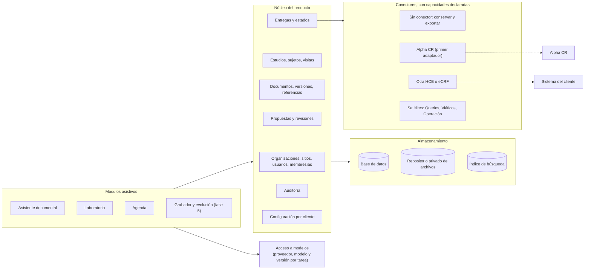

# Diagnóstico de independencia — ALPHI / Clinical Research OS

Fecha: 2026-11-11 · Base: `main` en `09cf8a6` · Alcance: lectura de código, PRs, CI y despliegues. Durante este diagnóstico no se aplicaron migraciones, no se mergeó ni se desplegó nada.

**Pregunta:** ¿qué cambios mínimos necesita lo construido para que CINME sea el primer cliente de un producto que también funcione en otro centro, con o sin Alpha CR?

## Respuesta corta

El producto **no depende de Alpha CR**: en `apps/`, `packages/` y `scripts/` no hay una sola referencia a ese sistema. El problema es el inverso. No existe la frontera donde un sistema clínico se enchufa: no hay contrato de conector, no hay estado de entrega y no hay mapeo de identificadores externos. Hoy "confirmar" un laboratorio significa guardarlo en Alphi, y la pantalla lo dice con palabras que pueden leerse como registro clínico.

El aislamiento entre organizaciones está construido y probado. Lo que impide sumar un segundo centro son seis cosas concretas, no la arquitectura:

1. Los módulos satélite (Queries, Viáticos, Operación) se configuran con una URL global por entorno: el segundo centro vería las tarjetas apuntando a los sistemas de CINME.
2. No hay política de conservación de evidencia: el PDF de laboratorio no se guarda y, en el PR #86, la imagen se borra al confirmar. Después de confirmar no se puede volver a ver el original.
3. No hay estados de entrega ni contrato de conector.
4. La escritura del perfil del sujeto es leer-modificar-escribir sin control de versión: dos confirmaciones simultáneas sobre el mismo sujeto pueden perder datos.
5. No hay membresía por estudio ni uso real de "sitio": quien tiene rol en la organización accede a todos sus estudios.
6. No hay entorno de prueba separado con datos sintéticos.

Nada de esto exige reescribir. Son seis cambios acotados sobre lo que ya existe.

## A. Estado comprobado

Cuatro niveles, que no son equivalentes: **código** (existe en una rama), **probado** (tiene pruebas automáticas en verde), **integrado** (funciona contra servicios reales) y **desplegado** (está en producción).

| Capacidad | Código | Probado | Integrado | Desplegado |
|---|---|---|---|---|
| Asistente documental por estudio, RAG con citas | `main` | Sí | Sí, en uso | Sí |
| Ingesta y versionado de documentos | `main` | Sí | Sí | Sí |
| Aislamiento por organización y estudio | `main` | Sí: suites de fuga en `auth`, `rag`, `db` y `web`, bloqueantes en CI | — | Sí |
| Roles y auditoría | `main` | Sí | Sí | Sí |
| Panel OS (cáscara, Inicio) | `main` (#81) | Sí | Sin recorrido con sesión verificado | Sí, `ALPHI_OS=on` |
| Contrato con satélites (JWT, solo lectura) | `main` (#80) | Sí | **No**: ningún satélite expone el endpoint | Sí, sin URL configurada |
| Laboratorio desde PDF con texto | `main` (#83, #84) | Sí, y con cinco informes reales en local | Sin recorrido con sesión verificado | Sí |
| Laboratorio desde foto o escaneo, segunda lectura | PR #86 abierto | Sí, con modelos simulados y Chrome real | **No**: ninguna llamada real a un modelo | No |
| Agenda | PR #87 abierto | Sí | No | No |
| Tablas `lab_report_images`, `agenda_items` | PR #85 abierto | Sí | Migraciones `0013`/`0014` **sin aplicar** | No |
| Volcado a Alpha CR | **No existe** | — | — | — |

Estado de las referencias de la revisión anterior: #75, #79, #80, #81, #83 y #84 mergeados. #77 (Blob *fail-closed*) **abierto**. #85, #86 y #87 abiertos y apilados. Issue #76 (orden del journal de migraciones) **abierto**. CI en `main`: en verde.

**Laboratorio y Alpha CR, estado actual.** Confirmar un informe hace dos cosas, ambas dentro de Alphi: marca `lab_reports.status = 'confirmed'` y fusiona los valores en `patient_profiles` (`apps/web/lib/labs/lab-report-service.ts`, `confirmLabReport`). No hay transferencia a ningún sistema externo, ni código que la intente. La pantalla dice "Los valores ya forman parte del registro del sujeto" (`components/labs/review-client.tsx:131`): es cierto para Alphi y engañoso si se lee como historia clínica.

**Qué no demuestra esto.** Las pruebas verifican reglas de programa. No hay validación clínica de la calidad de extracción, ni medición de exactitud sobre un conjunto de informes reales con resultado esperado.

## B. Matriz de independencia

| Componente | Reutilizable hoy | Dependencia existente | Impacto para un segundo cliente | Cambio mínimo | Evidencia |
|---|---|---|---|---|---|
| Organizaciones y aislamiento | Sí | Ninguna de cliente | Ninguno | — | `organization_id` obligatorio; `packages/db/tests/leakage` |
| Sitios | No | Tabla `sites` definida y **sin uso** fuera del esquema | Organización = sitio. Un cliente con varias sedes no se puede representar | Decidir: usar `sites` o declararlo fuera de alcance del piloto | `schema/sites.ts`; cero usos en `apps/web` |
| Membresía por estudio | No | Acceso por rol de organización | Todo el que tiene rol ve todos los estudios del centro | Tabla de membresías y filtro en `validateStudyAccess` | `packages/auth/roles.ts`; no existe tabla de membresías |
| Identidad | Sí | Clerk: 5 archivos en `packages/auth`, 19 en `apps/web/app`; `organizations.clerk_org_id` | Ninguno mientras el cliente acepte Clerk | Ninguno ahora. Aislar detrás de `packages/auth` solo si un cliente exige su propio proveedor | `schema/organizations.ts:31` |
| Estudios, documentos, versiones | Sí | Ninguna de cliente | Ninguno | — | `documents`, `document_versions` |
| Sujetos | Sí | Solo `subject_code` interno | No hay con qué enlazar al sujeto del sistema clínico | Mapeo explícito de identificadores externos | `schema/subjects.ts` |
| Visitas | No en `main` | `agenda_items` solo en #85 | El contexto de visita no existe en el núcleo | Definir visita en el núcleo antes de ampliar Agenda | PR #85 |
| Archivos | Parcial | Vercel Blob, privado, en dos archivos, sin interfaz | Ninguno, salvo cliente que exija su almacenamiento | Interfaz de almacenamiento cuando haya un segundo proveedor, no antes | `blob-storage.ts:35`, `ingestion/blob-read.ts:68` |
| Evidencia de laboratorio | No | El PDF no se guarda; la imagen se borra al confirmar (#86) | No se puede volver a consultar el original | Política de conservación por organización | `lab-report-service.ts`; `lab-image-report.ts` en #86 |
| Modelos | Sí | Multiproveedor con claves por organización. Excepciones: extracción de especificaciones fijada a Anthropic; proveedor de embeddings global | Un cliente no puede elegir proveedor para esas dos tareas | Hacer configurable la extracción; documentar que cambiar embeddings obliga a reindexar | `ingestion/spec-extractor.ts:93`; `ingestion/embedding-config.ts:22` |
| Trazabilidad de modelo | Parcial | `usage_events` guarda proveedor y modelo; el informe de laboratorio guarda solo el proveedor | No se sabe con qué versión se leyó un informe | Guardar modelo junto al informe | `schema/usage-events.ts`; `lab-report-content.ts` en #86 |
| Satélites | No | URL por variable de entorno global (`OS_QUERIES_URL`, …) | **Bloqueante**: todos los centros apuntarían a los sistemas de CINME | Configuración de integraciones por organización | `packages/integrations/config.ts:3-6` |
| Conector a sistema clínico | No existe | — | No hay modalidad A ni B | Contrato de conector con capacidades declaradas | Cero referencias en código |
| Auditoría | Sí | Solo-agregar por convención, sin protección en la base | Suficiente para piloto; no para una afirmación de inalterabilidad | Revocar `UPDATE`/`DELETE` al rol de la aplicación | `schema/audit.ts`; cero `update`/`delete` sobre `auditLogs` |
| Conversaciones | Sí | Filtradas por usuario | Ninguno | — | `lib/chat/persistence.ts:71` |
| Configuración por cliente | Parcial | `rag_config`, claves de modelos, presupuesto. Zona horaria, idioma y `ALPHI_OS` son globales | Un centro en otro huso o país comparte la configuración de CINME | Mover zona horaria y módulos habilitados a la organización | `schema/organizations.ts:36-46`; `lib/flags.ts` |
| Marca | No | Pie "v1.0 MVP · CINME / Innova Trials"; páginas legales nombran a CINME | El segundo cliente ve el nombre del primero | Texto por organización o neutro | `app/(app)/layout.tsx:158` |
| Lector de laboratorio | Parcial | Reglas afinadas a informes argentinos (DNI, obra social, coma decimal) | Otro país necesita ajustar reglas de encabezado | Ninguno para un segundo centro argentino | `packages/clinical/lab-report-parser.ts` |

**Otros repositorios.** `cinme-query-automation`, `korozov` y `proyecto_cordoba` son herramientas de un solo cliente; en el producto son módulos opcionales por organización. `proyecto_cordoba` ya reserva campos para identificadores de Alpha CR, marcados "futura integración": confirma que tampoco ahí hay integración real. `data_extractor` es una búsqueda de estudios clínicos sin relación con Alpha CR ni con datos de pacientes.

## C. Mapa de datos

| Clase | Sistema de registro hoy | Dónde | Ámbito | Versionado | Conservación | Original → extracción → revisión |
|---|---|---|---|---|---|---|
| Documentos de estudio (protocolo, IB, manuales) | Alphi | Vercel Blob privado + `documents` / `document_versions` | Organización, estudio | Sí | Indefinida; sin borrado implementado | Original guardado; texto en `pages`/`chunks`; citas con página |
| Índice de búsqueda | Derivado | Postgres con pgvector (`chunks`) | Organización, estudio | Por versión de documento | Se regenera | Derivado del original |
| Especificación del estudio | Alphi | `study_specs` | Organización, estudio | Por extracción | Indefinida | Extracción automática; revisión humana parcial |
| Perfil del sujeto, evoluciones, screening | Alphi | Postgres, cifrado en reposo | Organización, estudio, sujeto | No: se pisa el perfil | Indefinida | Sin original adjunto |
| Informe de laboratorio | Alphi | `lab_reports`, contenido cifrado | Organización, estudio, sujeto | No | Indefinida | **Original no guardado**; transcripción guardada; revisión con usuario, fecha y hora |
| Imagen de laboratorio (#86) | Alphi, transitorio | `lab_report_images`, cifrada | Organización, estudio, informe | No | **Se borra al confirmar o rechazar** | El original desaparece cuando termina la revisión |
| Conversaciones | Alphi | `conversations`, `messages`, `citations` | Organización, estudio, usuario | No | Indefinida | — |
| Auditoría | Alphi | `audit_logs` | Organización, estudio | Solo-agregar | Indefinida | — |
| Audio y transcripción | No existe | — | — | — | — | — |
| Datos confirmados en el sistema clínico | No existe | — | — | — | — | — |

**Dónde debería guardarse en cada modalidad**

| Clase | A. Con Alpha CR | B. Con otra HCE o eCRF | C. Independiente |
|---|---|---|---|
| Documentos de estudio | Alphi | Alphi | Alphi |
| Original de laboratorio | Referencia verificable al original en el sistema clínico (identificador + hash); copia según política | Igual que A | Alphi conserva el original cifrado según política del cliente |
| Extracción y revisión | Alphi | Alphi | Alphi |
| Dato clínico definitivo | El sistema clínico | El sistema clínico | Alphi como registro de la extracción revisada; exportable. No es una HCE |
| Estado de entrega | Alphi, por conector | Alphi, por conector | "Sin sistema de destino" |

**Sin definir hoy para ninguna clase:** plazo de conservación, eliminación, respaldo y recuperación. `docs/OPERATIONS.md` no describe copias ni restauración.

## D. Diagrama de arquitectura objetivo

Lo que existe hoy: todo el núcleo salvo "sitios y membresías", "visitas" y "entregas"; los módulos de asistente y laboratorio; los tres almacenes (sin interfaz); el acceso a modelos; y el contrato de satélites. Lo que falta es la columna de entregas y la caja de conectores.

**Contrato de conector propuesto** (cinco operaciones, todas opcionales, declaradas por capacidad):

- `resolverContexto`: dado un sujeto o una visita interna, devuelve su identificador externo.
- `obtenerDocumento`: trae un documento o su referencia.
- `entregarPropuesta`: entrega una propuesta revisada y devuelve un identificador de entrega.
- `consultarEntrega`: devuelve el estado en el destino, si el destino lo permite.
- `abrirRegistro`: URL para abrir el registro correcto en el sistema clínico.

Un conector declara qué soporta. "Sin conector" soporta solo exportar. Un sistema sin API puede soportar solo `abrirRegistro`.

**Cuatro estados, que hoy están colapsados en uno**

| Estado | Significado | Hoy |
|---|---|---|
| Propuesta | El programa leyó y propone | `pending_review` |
| Revisada | Una persona revisó y aceptó dentro de Alphi | `confirmed` |
| Entregada | Se envió al sistema de destino | No existe |
| Registrada en destino | El sistema clínico confirmó que la tiene | No existe |

Regla: la pantalla nunca muestra "registrado en Alpha CR" sin el cuarto estado, y el cuarto estado solo existe si el conector declara que puede verificarlo.

## E. Riesgos priorizados

Formato: hallazgo · evidencia · impacto · acción · sin verificar.

### Bloqueantes del flujo actual

**E1. Dos confirmaciones simultáneas sobre un sujeto pueden perder valores.**
Evidencia: `confirmLabReport` carga el perfil, lo fusiona y lo escribe; la escritura es un `update` simple (`lib/subjects/patient-profile-service.ts:147` y `:175`), sin versión ni bloqueo. La doble confirmación del mismo informe sí está cubierta (actualización condicional).
Impacto: pérdida silenciosa de datos revisados, justo en el escenario de CINME (varios profesionales a la vez).
Acción: escritura condicional sobre `updated_at` con reintento. No requiere migración.
Sin verificar: no se reprodujo; es una conclusión de lectura.

**E2. La pantalla de confirmación puede leerse como registro clínico.**
Evidencia: `review-client.tsx:131` y `:311`.
Impacto: un profesional puede creer que el dato está en la historia clínica.
Acción: decir "registro interno de Alphi" y, cuando no haya conector, "no se envió a ningún otro sistema".

**E3. La extracción de especificaciones depende de un único proveedor.**
Evidencia: `SPEC_EXTRACTION_LLM_PROVIDER = 'anthropic' as const` (`spec-extractor.ts:93`).
Impacto: si ese proveedor no responde, un protocolo nuevo queda sin especificación.
Acción: usar la cadena de proveedores del paquete de modelos, con el preferido primero.
Sin verificar: no se probó una ingesta real durante el diagnóstico.

**E4. PR #77 sin mergear.** Fuera de desarrollo, la subida de documentos puede caer a un almacenamiento local si falta el token. Acción: revisar y mergear #77.

**E5. Issue #76 abierto y migraciones a mano.** Las migraciones se aplican manualmente y el journal tiene un problema de orden conocido. `0013` y `0014` esperan. Acción: resolver #76 antes de aplicar más migraciones.

### Bloqueantes para un piloto en otro centro

**E6. Satélites configurados por entorno, no por organización.** `packages/integrations/config.ts:3-6`. Acción: tabla de integraciones por organización; sin fila, el módulo no aparece.

**E7. Sin política de conservación de evidencia.** El original de laboratorio no se guarda (PDF) o se borra (imagen, #86). Acción: política por organización — conservar cifrado, conservar referencia, o no conservar — y que el código la obedezca. Hasta decidirla, **#86 no debería mergearse con el borrado automático**.

**E8. Sin estados de entrega ni contrato de conector.** Acción: tabla de entregas y el contrato de la sección D, con el conector "sin destino" como primer caso.

**E9. Sin membresía por estudio.** Acción: tabla de membresías; `validateStudyAccess` la exige.
Sin verificar: cómo asigna CINME su personal a cada estudio.

**E10. Sin entorno de prueba separado.** La base llegó al límite de ramas y no hay copia para ensayar migraciones. Acción: un proyecto de base aparte con datos sintéticos.
Sin verificar: si las vistas previas usan la misma base que producción.

**E11. Configuración global que debería ser del cliente.** Zona horaria (#87), módulos habilitados (`ALPHI_OS`), marca. Acción: moverlas a la organización.

### Mejoras posteriores

- Interfaz de almacenamiento y de identidad: solo cuando haya un segundo proveedor real.
- Protección de la auditoría en la base (permisos del rol).
- Guardar modelo y versión junto a cada lectura de laboratorio.
- Cola para tareas largas: hoy la ingesta corre dentro de una función con `after()` (hasta 300 s) y un cron de recuperación. Alcanza para documentos; no para audio.
- Reglas de encabezado del lector por país.
- Respaldo y restauración documentados y ensayados.

Los hallazgos de configuración de producción (instancia de identidad, saldo de proveedores, custodia de la clave de cifrado) están en un anexo privado: este repositorio es público.

## F. Hoja de ruta

| Fase | Tarea | Depende de | Criterio de aceptación |
|---|---|---|---|
| 0 | Aprobar este diagnóstico y responder las decisiones de G | — | Decisiones registradas |
| 1 | **PR-1**: escritura atómica del perfil y texto honesto de confirmación (E1, E2) | — | Prueba que falla hoy con dos confirmaciones concurrentes y pasa después; el texto nombra "registro interno" |
| 1 | Mergear #77; resolver #76 | — | CI en verde; journal ordenado |
| 1 | Extracción de especificaciones con cadena de proveedores (E3) | — | Prueba con el proveedor preferido caído |
| 2 | Entorno de prueba con datos sintéticos (E10) | Decisión G7 | Migraciones `0013`/`0014` ensayadas ahí antes que en producción |
| 2 | Política de conservación por organización (E7) | Decisión G2 | #86 obedece la política; hay prueba para cada opción |
| 2 | Tabla de entregas y contrato de conector, con "sin destino" (E8) | — | Un informe revisado muestra "No enviado: sin sistema de destino" y se puede exportar |
| 2 | Integraciones y configuración por organización (E6, E11) | — | Dos organizaciones con módulos distintos en la misma instalación |
| 2 | Membresía por estudio (E9) | Decisión G3 | Prueba de fuga: usuario sin membresía no accede |
| 3 | Mapeo de identificadores externos y conector Alpha CR | Decisión G1 | Entrega con estado verificable, o capacidad declarada como "no verificable" |
| 4 | Demostración con dos centros ficticios (sección siguiente) | Fase 2 | Los seis criterios |
| 5 | Grabador y evolución asistida sobre los mismos contratos | Cola de tareas | Fuera del alcance de este documento |

**Primer PR recomendado: PR-1.** Es el único hallazgo que puede perder datos revisados hoy, no necesita migración, y deja instalada la distinción entre "revisado en Alphi" y "registrado en otro sistema" sobre la que se apoya todo lo demás.

**Sobre #85, #86 y #87.** Recomendación: no mergear todavía. #86 necesita la política de conservación (E7). #87 es Agenda, que esta misión pide no ampliar, y además define "visita" antes de que el núcleo la defina. #85 solo tiene sentido con los otros dos.

### Demostración de independencia (fase 4)

Dos organizaciones ficticias, creadas por un script de datos sintéticos, en el entorno de prueba.

- **Centro A:** conector "Alpha CR — simulador", rotulado como simulador en la pantalla y en la auditoría.
- **Centro B:** sin conector. Usuarios, estudios y documentos propios.

Criterios, cada uno con prueba automática:

1. **Aislamiento:** un usuario de B no puede leer por ninguna ruta un estudio, documento, sujeto, informe o conversación de A, y viceversa.
2. **Mismos módulos:** A y B usan el mismo despliegue y el mismo código; cambia solo la configuración.
3. **Configuración por cliente:** módulos habilitados, zona horaria y política de conservación distintos en A y B.
4. **Independencia:** B consulta un protocolo y revisa una extracción de laboratorio sin que exista ningún conector.
5. **Estados claros:** en A el informe pasa por propuesta → revisada → entregada (al simulador) → registrada; en B queda en revisada, con "sin sistema de destino", y se exporta.
6. **Sin escrituras automáticas:** ninguna entrega ocurre sin una acción explícita de una persona; la auditoría lo muestra.

Una simulación no se declara integración real: el conector de A lleva la palabra "simulador" en su nombre.

## G. Decisiones necesarias

| # | Pregunta | Opción recomendada | Consecuencia |
|---|---|---|---|
| G1 | ¿Qué mecanismo de integración ofrece Alpha CR: API documentada, acceso de lectura a su base, exportación, o solo pantalla? ¿Hay entorno de prueba? | Conseguir documentación y entorno de prueba. Mientras tanto, conector con "exportar" y "abrir registro" | Sin esto no se puede diseñar la entrega verificable. Que sus datos estén en Azure no da acceso |
| G2 | ¿Se conserva el original de un laboratorio después de revisarlo? | Configurable por cliente. Independiente: conservar cifrado. Integrado: referencia más hash | Define si #86 se puede mergear como está |
| G3 | ¿CINME necesita que cada persona vea solo sus estudios? | Sí | Agrega una tabla y un filtro; evita rehacer permisos con el piloto en marcha |
| G4 | ¿Se acepta mandar a un proveedor de modelos la transcripción de un laboratorio sin encabezado? | Configuración por cliente, apagada por defecto hasta tener acuerdo de datos con el proveedor | Sin segunda lectura, los PDF se leen solo por reglas |
| G5 | ¿Este repositorio sigue siendo público? | Pasarlo a privado | Hoy cualquier diagnóstico publicado acá es público |
| G6 | ¿Qué se hace con #85, #86 y #87? | Congelarlos hasta cerrar G2 y la fase 2 | Fotos, escaneos y Agenda no llegan a producción todavía |
| G7 | ¿Dónde vive el entorno de prueba? | Proyecto de base aparte, con datos sintéticos | Costo mensual adicional; permite ensayar migraciones |

## Infraestructura

| Servicio | Hoy | Recomendación | Punto único de fallo |
|---|---|---|---|
| Aplicación web | Vercel | Mantener | Vercel |
| Base de datos | Neon, un proyecto | Mantener; sumar proyecto de prueba y respaldo fuera de Neon | Sí: un proyecto, sin restauración ensayada |
| Archivos | Vercel Blob privado | Mantener | Sin copia fuera del proveedor |
| Procesos largos y colas | Función con `after()` y cron | **VPS**: trabajador con cola para audio y lecturas largas (fase 5) | — |
| Conectores | No existen | **VPS** cuando el sistema del cliente exija IP fija o red privada | — |
| Acceso a modelos | Proveedores externos con cadena de respaldo | Mantener | Un proveedor sin saldo degrada tareas fijadas a él (E3) |
| Identidad | Clerk | Mantener | Clerk |
| Monitoreo y copias | Sentry; sin copias documentadas | **VPS**: copia programada de la base y de los archivos, y prueba de restauración | — |

No conviene mover la aplicación ni la base al VPS: sería cambiar tres servicios administrados por una máquina que pasa a ser el punto único de fallo. El VPS suma donde hoy no hay nada: trabajos largos, conectores con red propia y copias.

## Qué quedó sin verificar

- Ningún recorrido con sesión iniciada en producción.
- Ninguna llamada real a un modelo para laboratorio (#86).
- E1 no se reprodujo con una prueba.
- Qué base usan las vistas previas.
- Los mecanismos de integración de Alpha CR: no hay documentación ni código en ninguno de los cinco repositorios.
- El contenido de `cinme-query-automation`, `korozov` y `proyecto_cordoba` se revisó por búsqueda, no archivo por archivo.
- Exactitud de la extracción sobre un conjunto de referencia.
